  <picture>
    <source media="(prefers-color-scheme: dark)" srcset="assets/banner-dunkel.svg">
    <source media="(prefers-color-scheme: light)" srcset="assets/banner-hell.svg">
    
  </picture>

Software developer and systems administrator. I build practical systems — backend services, databases, the apps that sit on top of them — and I run the infrastructure they live on myself.

I'd rather understand a system than memorize it, and I'd rather ship something useful than talk about it. Clear code, real problems, steady progress.

  <picture>
    <source media="(prefers-color-scheme: dark)" srcset="assets/welle-dunkel.svg">
    <source media="(prefers-color-scheme: light)" srcset="assets/welle-hell.svg">
    
  </picture>

## 道具 · Working with

By day: Windows infrastructure in the public sector — Citrix, Active Directory, Sophos firewalls, endpoints and networks.

Learning in the background:

  <picture>
    <source media="(prefers-color-scheme: dark)" srcset="assets/welle-dunkel.svg">
    <source media="(prefers-color-scheme: light)" srcset="assets/welle-hell.svg">
    
  </picture>

## 今 · Currently

- **[Vay Software](https://vaysoftware.com)** — a small IT company in the making that I'm part of, with two pillars: **managed IT support** for businesses of every size (email security, backups, updates, administration of servers, networks and firewalls) and **custom software development** (web applications, iOS and Android apps, integrations and automation). The website is hand-built and static: four languages including right-to-left Arabic, no cookies or tracking, a strict self-only Content Security Policy, its own contact-form backend, and an automated check before every release.
- **Gleisbau CRM** — business software for railway construction companies: customers, projects, staff and fleet, daily site reports with photos and signatures as PDF, time tracking and crew planning, invoices including the German e-invoice format XRechnung, roles and permissions, and a site report form that works offline on mobile. FastAPI, React 19, PostgreSQL, Docker. Around 600 automated tests (pytest, Vitest, Playwright click paths on desktop and mobile), CI on every push, versioned releases with an automated acceptance check. In development, running in test operation.
- **A community app, built with a second developer** — moved its backend from Supabase to a self-hosted PocketBase server with per-table access rules; client security review, Playwright coverage, CSP, all third-party libraries vendored and pinned. Pull requests only, never straight to `main`.
- **Running the platform myself** — a Debian home server with Docker services and a Windows VM behind a Hetzner VPS: nginx and Let's Encrypt, Tailscale, a self-hosted mail server (SPF, DKIM, DMARC, MTA-STS), monitoring with alerts, automated backups with restore tests, endpoint management (ManageEngine Endpoint Central, RustDesk), workflow automation with self-hosted n8n, and a power schedule that switches the home server off at night.
- **AI-assisted development as a daily tool** — Claude Code with MCP integrations, an Obsidian knowledge base that the agent maintains as its long-term memory (around 130 linked notes with typed relations), and my own Claude Code extensions: safety guards, usage and prompt-cache panels, automatic recall from the knowledge base, and a team of specialised agents for development, design, review, testing, copy, marketing, operations, research and documentation.
- **iOS development** with Swift and Xcode — a first own app (a visual focus timer) in the works — and a small 2D game in Godot on the side.

  <picture>
    <source media="(prefers-color-scheme: dark)" srcset="assets/welle-dunkel.svg">
    <source media="(prefers-color-scheme: light)" srcset="assets/welle-hell.svg">
    
  </picture>

## 環境 · Setup

- MacBook Pro 14" (M5, Apple Silicon), macOS — development and daily driver
- Debian home server (Docker, KVM, Tailscale) and an Ubuntu VPS at Hetzner (nginx, mail, n8n)
- My own Sophos Firewall (Home Edition) running in a VM, managed over Tailscale
- Windows machines only for the people I support

  <picture>
    <source media="(prefers-color-scheme: dark)" srcset="assets/welle-dunkel.svg">
    <source media="(prefers-color-scheme: light)" srcset="assets/welle-hell.svg">
    
  </picture>

## 道 · How I work

- Understand the system before changing it
- Clarity over cleverness
- Tests and a CI check before a deploy, every time
- Back up before every change on a server — and know the way back
- Document as I go, in a knowledge base rather than in chat history
- Ship, then refine

  <picture>
    <source media="(prefers-color-scheme: dark)" srcset="assets/welle-dunkel.svg">
    <source media="(prefers-color-scheme: light)" srcset="assets/welle-hell.svg">
    
  </picture>

## 連絡 · Contact

Most of my work lives in private repositories (client and personal projects). Happy to walk through code and architecture on request.

Open to collaboration and interesting problems — reach me at [info@vaysoftware.com](mailto:info@vaysoftware.com) or via [vaysoftware.com](https://vaysoftware.com).
